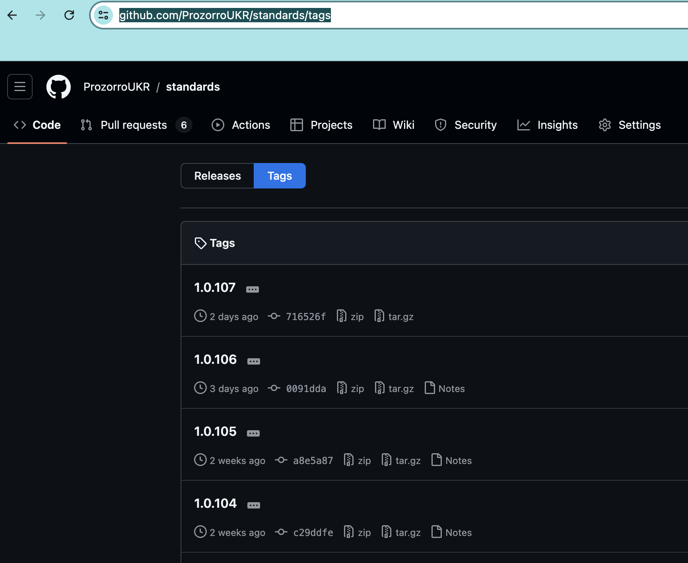
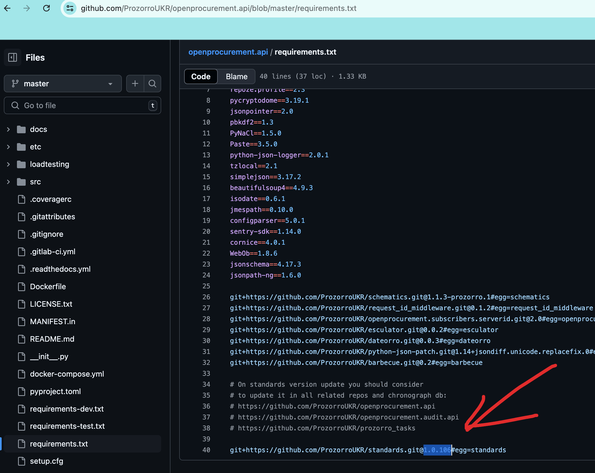
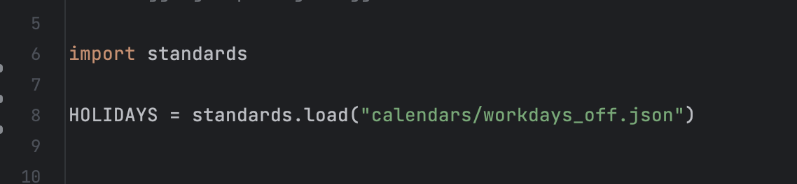

.. _cdb_standards:

Словники і стандарти
====================

Деякі поля апі мають валідацію на відповідність словнику. Словники зберігаються в `окремому репозиторії <https://github.com/ProzorroUKR/standards>`_.

Зміни до словників вносяться пул реквестами, після чього створюється `нова версія (тег) <https://github.com/ProzorroUKR/standards/tags>`_.

Для того щоб апі використовувало нову версію словників - вона вказується в `requirements.txt <https://github.com/ProzorroUKR/openprocurement.api/blob/master/requirements.txt>`_:

**Важливо повідомити клієнтів АПІ про перехід на нову в версію словників!**

Далі в коді досить легко імпортувати і використовувати будь який потрібний словник. Наприклад ось код для `словника вихідних днів <https://github.com/ProzorroUKR/standards/blob/master/calendars/workdays_off.json>`_.

Тож для використання нових словників/стандртів ми:

 - створюєм пул реквест зі змінами
 - отримуємо апруви і мержим
 - створюєм новий тег-версію
 - вказуємо цю версію в requirements.txt
 - реалізуємо зміни в коді

Динамічні словники (Dictionaries API)
-------------------------------------

Словники, що оновлюються частіше за релізи стандартів, ЦБД бере не з пакету `standards`, а з окремого сервісу
`prozorro-dictionaries`. Наразі це лише класифікатор КПК (бюджетні програми державного бюджету),
яким валідується `budget.breakdown.classification` плану: схеми ``КПК-<рік>`` і коди в них.

Код клієнта - `openprocurement.api.dictionaries`:

 - словник запитується цілим (``GET {dictionaries_api_host}/api/1.0/kpk/all.json``) при першій потребі в ньому
 - результат зберігається в пам'яті процесу (`cachetools.TTLCache`) і використовується до закінчення часу життя кешу, далі запитується знову
 - застарілу копію ЦБД не використовує: якщо словник треба запитати, а сервіс недоступний чи повернув неочікувану відповідь, запит до ЦБД завершується помилкою `502` ("Error while getting data from ProZorro Dictionaries. Try again later"). Помилка не кешується - наступний запит знову звернеться до сервісу
 - плани з класифікатором ТПКВКМБ до сервісу не звертаються

Налаштування:

 - ``dictionaries_api_host`` в ini файлі (секція ``[app:main]``) - адреса сервісу
 - змінна оточення ``DICTIONARIES_CACHE_TTL`` - час життя кешу в секундах (за замовчуванням 43200 - 12 годин)

В тестах до сервісу ніхто не звертається: autouse-фікстура `mock_dictionaries_api` підміняє його відповіді даними
з `openprocurement.api.tests.mock.MOCK_DICTIONARIES`.
